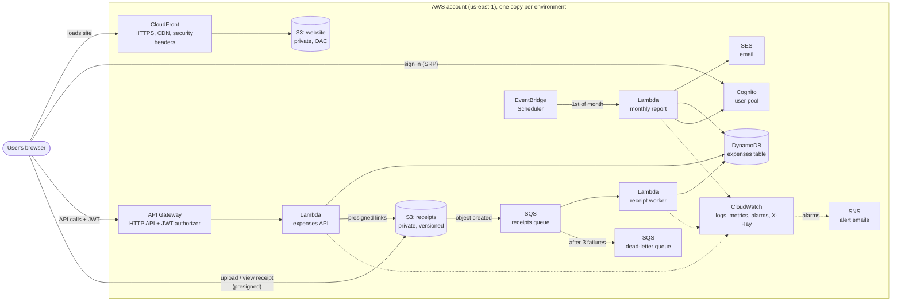

# Serverless Expense Tracker on AWS

A production-style serverless web application, built entirely as code with **Terraform** and deployed by a **GitHub Actions** pipeline.

Users sign up, record their expenses, attach photos of their receipts, and receive a spending summary by email at the start of every month. The application itself is deliberately simple; the focus of the project is the **infrastructure, security, automation, and operations** around it.

---

## Highlights

- **Fully serverless:** API Gateway, Lambda, DynamoDB, S3, CloudFront, Cognito, SQS, EventBridge Scheduler, and SES. No servers to manage, and close to zero cost at low traffic.
- **Everything as code:** about 100 AWS resources per environment, in reusable Terraform modules, with remote state and native locking.
- **Keyless CI/CD:** GitHub Actions authenticates to AWS with **OIDC**, so no AWS keys are stored anywhere. The trust policy is pinned to this repository's immutable owner and repository IDs.
- **Two environments, one design:** `dev` and `prod` are built from the same `stack` module and differ only in a short, explicit list of settings. Prod deployments require **manual approval**.
- **Quality gates on every change:** 43 Python unit tests (against a mocked AWS), 10 Terraform module tests (with a mocked provider), Checkov security scanning in enforce mode, and plans for both environments, all required before merging.
- **Event-driven processing:** uploaded receipts are validated in the background through S3 → SQS → Lambda, with a dead-letter queue and an alarm.
- **Observability:** API access logs, X-Ray tracing, symptom-based alarms (error rate, p95 latency), a CloudWatch dashboard, and saved Logs Insights queries.
- **Tested under pressure:** load, spike, memory-tuning, and disaster recovery drills, with measured results.

---

## Architecture



More detail, including sequence diagrams for each user journey and the data model, is in [docs/architecture.md](docs/architecture.md).

---

## Features

| Feature | How it works |
|---|---|
| Sign up, verify email, sign in | Cognito user pool. The website uses **SRP**, so passwords never leave the browser. |
| Add, edit, delete, and list expenses by month | REST API on API Gateway + Lambda, stored in DynamoDB using single-table design. |
| Upload and view receipts | **Presigned POST** uploads straight from the browser to a private S3 bucket (max 5 MB, JPEG/PNG/PDF), and presigned download links. |
| Background receipt validation | S3 → SQS → Lambda checks each file's real format from its first bytes ("magic numbers"), then marks it `ATTACHED` or deletes it as `REJECTED`. |
| Monthly spending summary | EventBridge Scheduler triggers a Lambda on the 1st of each month. It emails every user their previous month's totals via SES. Safe to run more than once. |

---

## Tech stack

| Area | Technology |
|---|---|
| Infrastructure as code | Terraform (AWS provider 6.x), modules, remote state in S3 with native locking |
| Compute | AWS Lambda (Python 3.12, arm64 / Graviton) |
| API | Amazon API Gateway HTTP API, JWT authorizer |
| Data | Amazon DynamoDB (on-demand, PITR), Amazon S3 (versioned) |
| Identity | Amazon Cognito |
| Messaging and scheduling | Amazon SQS, Amazon EventBridge Scheduler, Amazon SES, Amazon SNS |
| Frontend | Static HTML, CSS, and JavaScript modules on S3 + CloudFront |
| Observability | CloudWatch Logs, Metrics, Alarms, Dashboards, Logs Insights, AWS X-Ray |
| CI/CD | GitHub Actions with OIDC |
| Testing | pytest + moto, `terraform test` with mock providers, Checkov, k6 |

---

## Repository structure

```
.
├── .github/workflows/terraform.yml   CI/CD pipeline
├── .checkov.yaml                     Security scan config and accepted risks
├── bootstrap/                        One-time setup: state bucket, OIDC provider, deploy role
├── envs/
│   ├── dev/                          Dev environment (calls modules/stack)
│   └── prod/                         Prod environment (calls modules/stack)
├── modules/
│   ├── stack/                        The whole application, wired together
│   ├── api/                          API Gateway, expenses Lambda, access logs
│   ├── auth/                         Cognito user pool and app client
│   ├── database/                     DynamoDB table
│   ├── frontend/                     Website bucket, CloudFront, security headers
│   ├── receipts/                     Receipts bucket
│   ├── receipt_processing/           SQS queue, DLQ, worker Lambda, alarm
│   ├── monthly_report/               Scheduler, report Lambda, SES identity, DLQ, alarm
│   ├── monitoring/                   SNS alerts topic
│   └── observability/                Alarms, dashboard, saved log queries
├── app/
│   ├── frontend/                     Website files (config.js is generated by Terraform)
│   └── lambdas/
│       ├── expenses_api/             handler.py, repository.py, storage.py
│       ├── receipt_worker/
│       └── monthly_report/
├── scripts/
│   ├── upload_receipt.py             Uploads a receipt the way the browser does (testing)
│   └── restore_missing_items.py      Disaster recovery: copies lost items back
├── tests/
│   ├── test_*.py, conftest.py        Python unit tests
│   └── load/expenses_load.js         k6 load test
└── docs/                             Architecture, decisions, security, runbooks, reports
```

---

## Getting started

### Prerequisites

- An AWS account and the AWS CLI, configured with an administrator identity (for the one-time bootstrap).
- Terraform 1.10 or later.
- Python 3.12 (for tests and scripts).
- The GitHub CLI (`gh`).
- Optional: k6, for load tests.

### 1. Bootstrap (once per AWS account)

`bootstrap/` creates the Terraform state bucket, GitHub's OIDC provider, and the role the pipeline uses. Its own state stays local, because nothing else exists yet.

```bash
cd bootstrap
# terraform.tfvars needs: github_owner, github_repo, github_owner_id, github_repo_id
terraform init
terraform apply
terraform output
```

Back up `bootstrap/terraform.tfstate` somewhere safe. It is deliberately not committed.

### 2. Configure GitHub

Repository **variables** (Settings → Secrets and variables → Actions → Variables): `AWS_ROLE_ARN`, `AWS_REGION`, `TF_STATE_BUCKET`, `ALERT_EMAIL`, `REPORT_SENDER_EMAIL`.

Environments (Settings → Environments): `dev`, and `prod` with **required reviewers** and deployments restricted to `main`.

Branch protection for `main`: require a pull request, require all checks (listed below), require branches to be up to date, and do not allow bypassing.

### 3. Deploy

All deployments go through the pipeline. Open a pull request, review the plans, merge, then approve the prod deployment.

```bash
git checkout -b feature/my-change
# ...make changes...
git push -u origin feature/my-change
gh pr create --base main
gh pr checks --watch
gh pr merge --merge
```

After the first deployment, confirm the two subscription emails: **SNS** (alerts) and **SES** (sender verification).

---

## Development

### Run the tests

```bash
python3.12 -m venv .venv
source .venv/bin/activate
python -m pip install -r requirements-dev.txt
pytest                                   # 43 unit tests, no AWS needed

for m in database auth receipts; do      # 10 Terraform module tests
  (cd modules/$m && terraform init -input=false >/dev/null && terraform test)
done

checkov -d . --config-file .checkov.yaml # security scan
```

### Run the website locally (dev only)

```bash
BUCKET=$(cd envs/dev && terraform state show 'module.stack.module.frontend.aws_s3_bucket.site' \
  | grep -E '^\s+bucket\s+=' | awk -F'"' '{print $2}')
aws s3 cp "s3://$BUCKET/config.js" app/frontend/config.js
cd app/frontend && python3 -m http.server 8080
```

Open http://localhost:8080. Dev's API allows this origin in CORS; prod's does not. `app/frontend/config.js` is ignored by Git and never uploaded.

### Load test (dev only)

```bash
k6 run -e API_URL="$API" -e TOKEN="$TOKEN" -e RATE=5 -e DURATION=2m tests/load/expenses_load.js
```

---

## Environments

| Setting | dev | prod |
|---|---|---|
| Deletion protection (table, user pool) | Off | **On** |
| CLI password login (`USER_PASSWORD_AUTH`) | On | **Off** |
| Extra CORS origins | `http://localhost:8080` | None |
| Creates the SES sender identity | Yes | No (same account) |
| Deployment | Automatic on merge | **Manual approval** after dev succeeds |

---

## CI/CD pipeline

| Stage | Jobs | AWS access |
|---|---|---|
| Checks (every PR and merge) | Unit tests, Module tests (database, auth, receipts), Security scan (Checkov) | None |
| Pull request | Plan (dev), Plan (prod) | Read via OIDC |
| Merge to `main` | Apply (dev) → **approval** → Apply (prod), same commit | Deploy via OIDC |

Required checks on `main`: **Unit tests**, **Module tests (database)**, **Module tests (auth)**, **Module tests (receipts)**, **Security scan (Checkov)**, **Plan (dev)**, **Plan (prod)**.

---

## Cost

At test-level traffic, both environments together cost **a few dollars a month or less**, mostly CloudWatch alarms beyond the free tier. Lambda, DynamoDB on-demand, S3, CloudFront, SQS, X-Ray, and Cognito all stay within or close to their free tiers at this scale. See the [performance report](docs/performance-report.md#cost) for per-request costs.

To remove everything, follow the **Teardown** section of the [operations runbook](docs/runbooks/operations.md#5-teardown).
